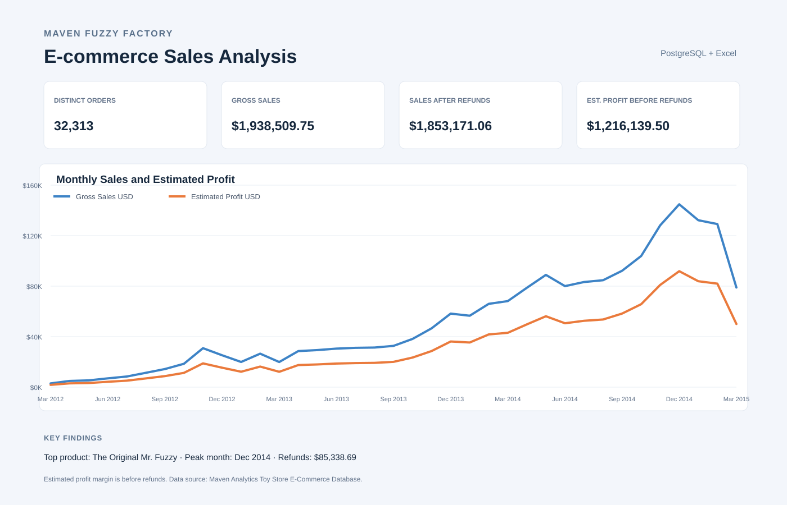

# Maven Fuzzy Factory E-Commerce Analysis

## Project overview
I analyzed e-commerce orders, products, refunds, and website sessions using PostgreSQL and Excel. The project combines SQL data preparation and analysis with Excel formulas and reporting.

## Business questions
- Which products generated the most sales and estimated profit?
- How did sales, profit, and refunds change month by month?
- How did session-to-order conversion vary by traffic source, campaign, and device?

## Tools and skills
- PostgreSQL: raw and staging schemas, data quality checks, joins, aggregations, views, and conversion-rate analysis
- Excel: XLOOKUP, SUMIFS, COUNTIFS, IFERROR, EDATE, formulas, tables, and charts

## Key findings
- The project contains 32,313 distinct orders and 40,025 order-item lines.
- Gross sales were $1,938,509.75; refunds were $85,338.69; sales after refunds were $1,853,171.06.
- Estimated profit before refunds was $1,216,139.50, with an estimated pre-refund margin of 62.74%.
- The Original Mr. Fuzzy generated the highest product sales: $1,211,057.74.
- December 2014 had the highest monthly gross sales: $144,823.02.
- For gsearch/nonbrand, desktop conversion was 8.22% and mobile conversion was 3.18%.

## Project workflow
1. Imported the source CSV files into PostgreSQL raw tables.
2. Checked row counts, key uniqueness, missing values, and table relationships.
3. Created typed staging views.
4. Analyzed product sales, refunds, monthly trends, and session conversion in SQL.
5. Exported selected SQL results to Excel.
6. Used Excel formulas to enrich and summarize the results, then created a monthly chart and executive summary.

## Preview

## Files
- `sql/` — SQL scripts for table setup, data checks, staging views, and analysis
- `data/processed/` — selected SQL outputs exported for Excel
- `Maven_Fuzzy_Factory_SQL_Excel_Analysis.xlsx` — Excel report and formula practice
- `screenshots/executive_summary_preview.svg` — static preview of the Excel executive summary

## Reproducing the analysis
1. Create a PostgreSQL database and run the scripts in `sql/` in numeric order.
2. Import the source CSVs into the matching `raw` tables created by `01_create_raw_tables.sql`. Keep the CSV header row enabled during import.
3. Run `02_raw_data_quality_checks.sql`, then `03_create_staging_views.sql`, then the analysis queries in `04_sql_analysis.sql`.
4. Open the Excel workbook and review the included formula practice and report sheets. The processed CSV exports in `data/processed/` are included so the Excel work can be reviewed without rerunning SQL.

The raw CSV filenames are `products.csv`, `orders.csv`, `order_items.csv`, `order_item_refunds.csv`, `website_sessions.csv`, and `website_pageviews.csv`. The data dictionary is also available in the source download.

## Data source
[Maven Analytics Toy Store E-Commerce Database](https://status.mavenanalytics.io/data-playground/toy-store-e-commerce-database)

The dataset page identifies Maven Analytics as the source and lists the license as Public Domain.

The original CSV files are kept out of this repository to keep the upload lightweight. Download them from the source page above and place them in `data/raw/` before reproducing the analysis.
